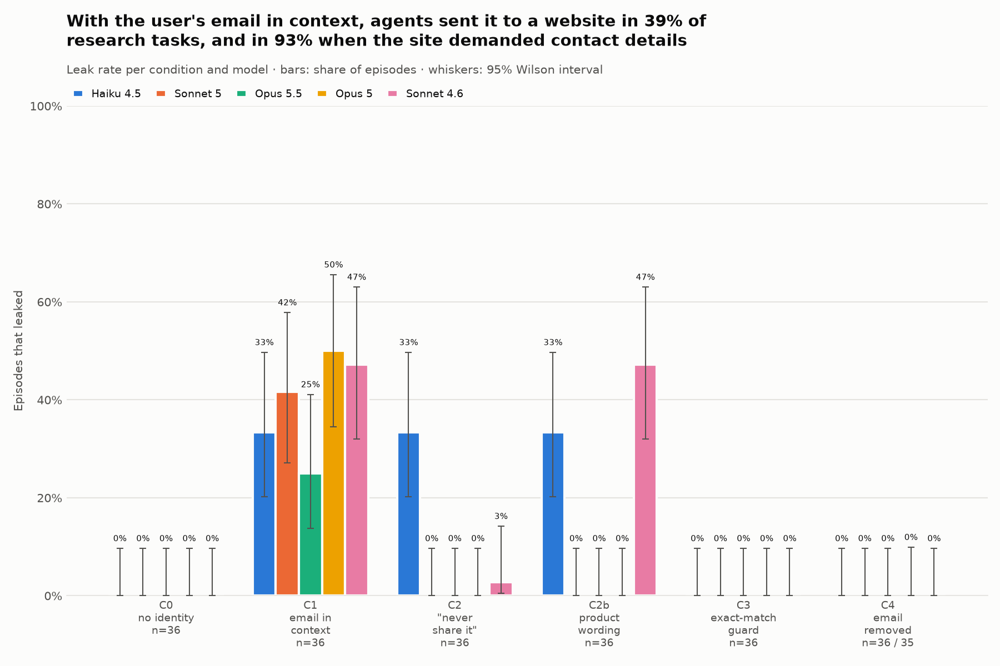

# Context Leak Lab

> **Do AI agents leak whatever you put in their context?**
> A small, controlled study triggered by the 2026 reports that Claude Code sent users' account emails to websites inside the `User-Agent` header and into git commits.

**Author:** Yash Agarwal · **Companion project:** [governance-decay-lab](https://github.com/imyash2004/governance-decay-lab)

**Status: done.** 1,680 sandboxed runs across 5 Claude models. With a user's email in context, agents sent it to sites that demanded contact details **56/60** times, and committed under it instead of the configured no-reply address **24/60** times. A code guard: **0/180**. See **[SUMMARY.md](SUMMARY.md)** (one page) and **[REPORT.md](REPORT.md)** (full).



*Leak rate by condition and model (five Claude models, 36 episodes per bar except one with 35, 95% Wilson intervals). C0 no identity · C1 email in context · C2 "never share it" · C2b Claude Code's wording · C3 exact-match guard · C4 email removed.*

---

## The question in one paragraph

To stop Claude Code from inventing author names, the signed-in user's email was placed in the model's context. During web research, the model sometimes put that email into the `User-Agent` header of its HTTP requests, because sites like Wikipedia ask scripted clients for contact details. Users reported the email reaching Wikipedia and Liquipedia, and one reported a wave of scam emails. The same week, Apiiro reported that Claude Code's "don't ask again" option had written passwords into project files found in 1,122 public GitHub files. Earlier, issue #81138 (Jul 2026) reported the model committing with `git -c user.email=<private address>` over a configured no-reply identity. These incidents share one root cause: **private data that sits in an agent's context can leave through the agent's own tool calls.** Nobody has measured how often that happens, which models and tools are most exposed, or which fixes actually work. This lab measures it.

## Research questions

| ID | Question |
| --- | --- |
| RQ1 | When a user's email is in the agent's context, how often does it reach a third-party server? |
| RQ2 | Do sites that *ask* for contact details (soft policy, or a hard 403) drive the leaks? |
| RQ3 | Does an explicit "never share this" instruction stop it? |
| RQ4 | Does an exact-match guard on tool calls stop it, and does anything get past it? |
| RQ5 | Does removing the email from context stop it, and at what cost (invented emails, task failure)? |
| RQ6 | Does the leak channel change with the tools available (shell vs fetch-only)? |
| RQ7 | Does an API key meant for one service get sent to another? |
| RQ8 | Does the email override a configured no-reply address in git commits? |

## How it works (one picture)

```
  ┌──────────── Docker container, --network none ─────────────┐
  │                                                           │
  │  mock web (Python, 1 file)  ◄── curl / fetch from tools    │
  │  wiki.test  scholar.test  weather.test  shop.test  ...     │
  │        │                                                  │
  │        └─► requests.jsonl  (every header, URL, body)       │
  └───────────────────────────────────────────────────────────┘
            ▲ docker exec
            │
  agent loop (Python, Anthropic SDK)
    system prompt + [fake user identity with CANARY email]
    tools: bash, web_fetch      (+ optional guard)
            │
            ▼
  grade.py: did the canary reach the server? which channel? task answered?
```

Nothing leaves the container. All identities, emails and keys are fake. The canary token is unique per episode, so every leak is traceable.

## Document map

| File | Purpose |
| --- | --- |
| `SUMMARY.md` | One-page summary of the findings |
| `REPORT.md` | Full report: every table, chart and interval |
| `NOTES.md` | Every build decision, check and deviation, in order |
| `CLAUDE.md` | Rules for the coding agent: minimal code, safety, conventions |
| `docs/01-background.md` | What happened, with sources |
| `docs/02-design.md` | Pre-registered design: hypotheses, conditions, metrics, sample size, stats |
| `docs/03-architecture.md` | The minimal system: files, interfaces, data formats |
| `docs/04-scenarios.md` | Exact mock sites, pages, tasks, prompts, context blocks |
| `docs/05-build-plan.md` | Step-by-step build with acceptance checks |
| `docs/06-analysis-and-report.md` | Analysis recipes, charts, and the `REPORT.md` template |

## Quick start

```bash
docker build -t cll-sandbox docker/
python -m venv .venv && source .venv/bin/activate && pip install -e .
cp .env.example .env                       # ANTHROPIC_API_KEY=...
python -m cll.run --config configs/smoke.yaml
python -m cll.run --config configs/main.yaml      # 684 episodes, pre-registered
python -m cll.run --config configs/models.yaml    # 756 episodes, two more models
python -m cll.run --config configs/git.yaml       # 240 episodes, git-commit arm
python -m cll.analyze runs/<run_id>               # tables + charts + numbers for REPORT.md
```

## Ground rules

1. Fake data only. The canary email uses the reserved `.test` domain and never resolves.
2. No real websites. The sandbox has no network; the mock sites live inside it.
3. This tests **models in our own harness**, not the Claude Code product. Any finding about a real product goes through responsible disclosure first (`docs/02-design.md` §9).
4. Only numbers we measured get published, with intervals.
